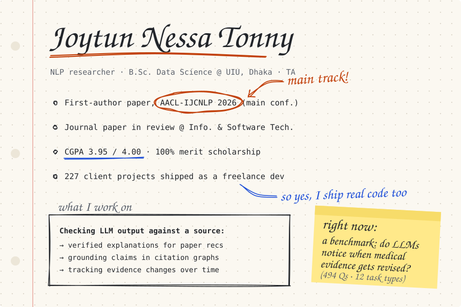

[website](http://joytunnessa.com) · [email](mailto:jtonny2330121@bsds.uiu.ac.bd) · [linkedin](https://www.linkedin.com/in/joytun-tonny/) · [x](https://twitter.com/joytun_tonny)

### Papers

- **HybridScholar: Personalized Paper Recommendation with Cross Attention-Gated Fusion and Verified Explanation Generation** 
  **J. N. Tonny**, S. Rahman, M. S. H. Mukta, S. Shatabda, S. Islam · *AACL-IJCNLP 2026, main conference* · [paper](PAPER-LINK)
- **Verifying Relational Claims in Agentic Recommendation Software Systems via Citation-Graph Grounding** 
  **J. N. Tonny**, S. Rahman, M. S. H. Mukta, M. A. Islam · *under review, Information and Software Technology*
- **WebSecure: A Post-Quantum P2P End-to-End Encrypted Chat Framework with Kyber Key Exchange and Adaptive Noise Injection** 
  S. Rahman, **J. N. Tonny**, M. A. Rahman, S. Alam, M. Hasan · *MCT4SD 2025* · [paper](PAPER-LINK)

### Things I've built

- **[NEW PROJECT](https://github.com/joytun-tonny/NEW-REPO)**: one line on what it does and what it achieved
- **[NeuroChain](https://github.com/joytun-tonny/REPO)**: early screening for neurodevelopmental conditions. Started as a DBMS lab project and made the top 20 at the SOLVIO National AI Hackathon 2026.
- **[ML From Scratch](https://github.com/joytun-tonny/ML-From-Scratch)**: 15 classic ML algorithms in plain NumPy, each checked against scikit-learn, with a Streamlit app to try them
- **[Dynamic Pricing Optimizer](https://github.com/joytun-tonny/Dynamic-Pricing-Optimizer-for-Ride-Sharing-Platforms)**: fare prediction on Uber/Lyft Boston data plus demand-based pricing with an elasticity model

### Teaching

TA at UIU since Summer 2025 for Database Management Systems, Data Structures & Algorithms II, and Programming for Data Science.

Python · PyTorch · TensorFlow · scikit-learn · Hugging Face · LangChain · FastAPI · React · Node.js · PostgreSQL · LaTeX
